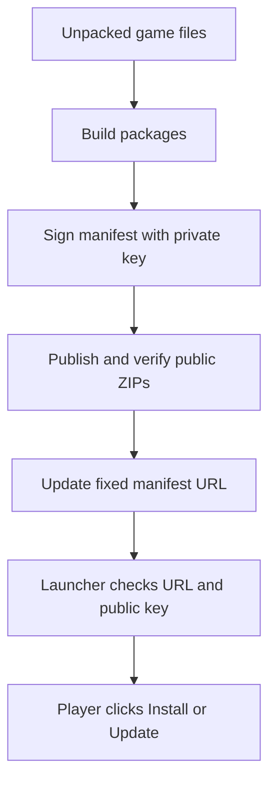

# Publishing game releases

For the desktop form with folder pickers and a single publishing button, see
[OpenBK2 Publisher](PUBLISHER_GUI.md). The walkthrough below covers the equivalent
command-line steps.

This walkthrough takes you from an empty GitHub repository to a game release
that the launcher can discover, download and update. Complete **Steps 1–8 once**,
then use **Steps 9–12 for each later game update**.

**The connection is a fixed manifest URL and a signing key.** Your production
launcher is built with that URL and the public half of your key. Publishing
uploads the game packages, then replaces the signed manifest at that same URL.
On its next update check, the launcher reads it and offers Install or Update.
There is no separate registration screen.



> The supplied demo/CI executables are **fixture builds**. Step 7 creates the
> production launcher that reads your public manifest. Uploading game files alone
> does not connect a fixture executable to your repository.

Jump to [first-time setup](#first-time-setup), [your first release](#your-first-release),
[later game data updates](#later-game-data-updates), or [troubleshooting](#troubleshooting).
Detailed archive, language, profile and mod rules are in the
[input reference](PUBLISHING_INPUTS.md).

## First time setup

### Step 1 Create a public GitHub repository

For this walkthrough, use **one repository** named `OpenBK2-Game-Releases` for
both game downloads and the manifest.

1. Sign in to GitHub and choose **New repository**.
2. Select your account or organization as the owner.
3. Name it `OpenBK2-Game-Releases` and choose **Public**.
4. Enable **Add a README file**, then create the repository.
5. Confirm it has a `main` branch. If the branch has another name, use that name
   for `$ManifestBranch` in Step 2.

The README initializes the repository before the publisher creates its first
release. See GitHub's [repository creation instructions](https://docs.github.com/en/repositories/creating-and-managing-repositories/creating-a-new-repository).

You do not need to clone this new repository, enable GitHub Pages, upload game
files to its Code tab, or create a release manually. The publisher uses the API.
It creates releases and the manifest file, but **does not create repositories**.

| Where | What goes there |
|---|---|
| Your existing launcher source checkout | The source code and `tools/release.py` |
| GitHub Releases in the new repository | Generated game ZIP packages, grouped under tags such as `v0.1.0` |
| The new repository's `main` branch | `manifest.envelope.json`, the signed pointer to the current game release |
| A private folder on your computer | Your signing key; never uploaded |

**You should now have:** a public repository containing a README on an existing
branch. The manifest URL will return 404 until you complete Step 6.

### Step 2 Prepare your local publishing workspace

The commands below use **Windows PowerShell**, run from your launcher source
checkout. Install Python 3.11 or newer, then confirm this command reports that
version and install the toolkit dependencies:

```powershell
python --version
python -m pip install -r tools/requirements.txt
```

If `python` opens the Microsoft Store or selects an older installation, use your
Python 3.11+ executable instead for every Python command below. Python is needed
only on the publishing computer; players do not need it.

Set these values in the **same PowerShell window**, replacing `YOUR_ACCOUNT`:

```powershell
$Owner = "YOUR_ACCOUNT"
$Repo = "OpenBK2-Game-Releases"
$ManifestRepo = "$Owner/$Repo"
$ManifestBranch = "main"
$ManifestUrl = "https://raw.githubusercontent.com/$ManifestRepo/$ManifestBranch/manifest.envelope.json"
$PublishingRoot = "$env:USERPROFILE/OpenBK2-Publishing"
$KeyDir = "$env:USERPROFILE/OpenBK2-Secrets"
$PrivateKey = "$KeyDir/release.pem"
$KeyId = "release-key-2026-01"

New-Item -ItemType Directory -Force -Path $KeyDir,
    "$PublishingRoot/input/shared", "$PublishingRoot/input/windows",
    "$PublishingRoot/input/linux", "$PublishingRoot/input/languages",
    "$PublishingRoot/releases" | Out-Null
```

These folders live outside the launcher checkout. `$PublishingRoot` holds your
prepared files and release outputs; it is separate from each player's chosen
installation folder.

Save the variable assignments as your publishing notes so you can restore them
in a new shell. They contain paths and public identifiers, not key contents or
tokens. A separate manifest repository is also supported: create and initialize
it, then set `$ManifestRepo = "$Owner/OpenBK2-Manifest"` before setting the URL.

**You should now have:** four empty input folders, a releases folder, and a
separate secrets folder.

### Step 3 Generate your signing key once

Protect `$KeyDir` with restrictive Windows permissions before generating the
key: in its **Properties > Security** settings, limit access to trusted accounts.
The generated PEM is unencrypted, so its file permissions and backup matter.

```powershell
python tools/release.py keygen --output-private "$PrivateKey"
```

The command creates `release.pem` and prints `Public key:` followed by **64 hex
characters**. Copy only those characters into this variable:

```powershell
$PublicKey = "PASTE_THE_64_HEX_CHARACTERS_HERE"
```

| Value | Purpose | Where it belongs |
|---|---|---|
| `release.pem` | Signs releases as coming from you | Private folder and secure backup |
| `$PublicKey` | Lets launchers verify your signature | Publishing notes and production launcher build |
| `$KeyId` | Identifies which trusted key signed the manifest | Same exact value in signing, verification and launcher build |
| GitHub token | Permits uploads and manifest commits | Secret manager or current publishing process |

The key ID is a label you choose; `release-key-2026-01` is ready to use.
Back up the private key securely and save the public key and key ID. **Reuse
this key for later releases.** Key generation refuses to overwrite an existing
file or write inside this launcher repository. Do not rerun it for every update.
Signing can also read the key path from `OPENBK2_SIGNING_KEY_FILE`.

**You should now have:** one private PEM file, its public key, and a key ID. Never
paste the PEM contents into a build command, GitHub file, or release asset.

### Step 4 Create a GitHub publishing token

In your GitHub account settings, open **Developer settings > Personal access
tokens > Fine-grained tokens**, then generate a token with:

1. The repository's account or organization as **Resource owner**.
2. **Only select repositories**, including `OpenBK2-Game-Releases` and, if used,
   your separate manifest repository.
3. Repository permission **Contents: Read and write**.
4. An expiration appropriate for your publishing schedule.

Save the token in your secret manager. If an organization requires approval,
wait until it approves the token. See GitHub's
[token setup instructions](https://docs.github.com/en/authentication/keeping-your-account-and-data-secure/managing-your-personal-access-tokens)
and the permissions for [release creation](https://docs.github.com/en/rest/releases/releases#create-a-release)
and [file updates](https://docs.github.com/en/rest/repos/contents#create-or-update-file-contents).

When ready to publish, load it into the current shell without putting its value
in command history:

```powershell
$TokenInput = Read-Host "Paste GitHub publishing token" -AsSecureString
$env:GITHUB_TOKEN = [System.Net.NetworkCredential]::new("", $TokenInput).Password
Remove-Variable TokenInput
```

The toolkit reads `GITHUB_TOKEN` directly; signing in to GitHub in your browser
does not set it. Players receive neither this token nor your private key. All
manifest and package URLs must be accessible without authentication.

**You should now have:** upload access for this PowerShell session. No token is
needed for building, signing, verification, or the publication dry run.

## Your first release

### Step 5 Prepare the unpacked game files

Copy your actual built game files into the input folders. Together, `shared`,
`initial` and each platform folder must make a complete installation for that platform.
Here is a minimal layout; `base.pak` and the library names are examples:

```text
OpenBK2-Publishing/
  input/
    shared/
      Data/
        base.pak
      splash.bmp
    initial/
      Editor/
        default.cfg
      Profiles/
        default.cfg
    windows/
      bin/
        Game.exe
        WindowsOnly.dll
    linux/
      bin/
        Game
        libLinuxOnly.so
    languages/
      texts-en.pak
      texts-de.pak
  releases/
```

1. Extract common `data.zip` contents into `input/shared/Data/`, preserving the
   game's paths. If the archive already contains `Data/`, extract at `shared/`
   to avoid accidentally making `Data/Data/`.
2. Extract the Windows `bin.zip` so the executable is
   `input/windows/bin/Game.exe`. Extract the Linux one so its executable is
   `input/linux/bin/Game`.
3. Put immutable common extras in their game-relative locations under `shared/`.
   Put game-modified defaults, including `Editor/` and `Profiles/`, under
   `input/initial/` instead. Keep their game-relative folder names. Supply only
   clean defaults, never your personal saves/settings. See [initial data](PUBLISHING_INPUTS.md#initial-data).
4. Put language files directly in `input/languages/` as `texts-en.pak`,
   `texts-de.pak`, etc. Supply at least one. They are installed under `Data/`.
5. Check that no path in `shared/` also exists in a platform folder. Shared
   files are packaged once and combined with the player's native platform.

The publisher consumes **unpacked files** and generates its own ZIPs. The root
is the folder containing `bin/`, not `bin/` itself. The current toolkit requires
the executable names above and uses `bin/` as the working directory.

`Profiles/` and `MODs/` are excluded from base inputs unless you opt in exact
immutable official files. The initial-data input includes `Profiles/` without
that opt-in. Before including `profiles.zip` or downloadable mods, follow
the [profile and mod instructions](PUBLISHING_INPUTS.md#profiles-mods-and-language-files).
Linux helper executables need their execute bits preserved; package on Linux
if your Windows extraction process cannot preserve them.

**You should now have:** complete unpacked inputs, with real game executables
and at least one language pack. A data-only folder is not a full release.

Initial data requires launcher **0.3.0 or newer**. When upgrading an existing
deployment, rebuild/distribute the production launcher with its existing URL/key
before publishing a manifest that uses `--shared-init-data`.

Launcher **0.3.1+** also supports `input/initial/Data/` alongside managed
`input/shared/Data/`. Put each file in only one input: file collisions, case
aliases, file/directory conflicts and overlaps with language packs are rejected.
Reset restores only listed initial files inside `Data/`, preserving its other
content. The publisher sets the required launcher version automatically.

### Step 6 Build sign and publish the first release

Run each block in order and stop if any command reports an error.

**6a. Choose the game version and release number.** These are independent of the
launcher version. The sequence is the increasing integer used to detect updates.

```powershell
$Version = "0.1.0"
$Sequence = 1
$Tag = "v$Version"
$ReleaseDir = "$PublishingRoot/releases/$Version"
$BaseUrl = "https://github.com/$Owner/$Repo/releases/download/$Tag"
$CreatedUtc = (Get-Date).ToUniversalTime().ToString("yyyy-MM-ddTHH:mm:ssZ")
```

**6b. Build locally.** The output directory must be absent or empty. PowerShell
backticks continue the command onto the next line; do not add spaces after them.

```powershell
python tools/release.py build `
    --version "$Version" --sequence $Sequence `
    --shared-root "$PublishingRoot/input/shared" `
    --shared-init-data "$PublishingRoot/input/initial" `
    --windows-root "$PublishingRoot/input/windows" `
    --linux-root "$PublishingRoot/input/linux" `
    --languages-dir "$PublishingRoot/input/languages" `
    --base-url "$BaseUrl" --created-utc "$CreatedUtc" `
    --out "$ReleaseDir"
```

If you only ship Windows, omit `--linux-root` in this and future builds. Keep
every platform you support in every release. Add any profile, mod or exclusion
options from the input reference consistently to each build.

Expected message: `Built and verified unsigned release:` followed by your output
path. Nothing has been uploaded yet.

**6c. Review, sign and verify.** Open `manifest.payload.json` in the output folder
to review the version, sequence, file paths, launch profiles and download URLs.
Then run these commands individually:

```powershell
python tools/release.py sign --release-dir "$ReleaseDir" --private-key "$PrivateKey" --key-id "$KeyId"
python tools/release.py verify --release-dir "$ReleaseDir" --key-id "$KeyId" --public-key "$PublicKey"
```

Verification should report:
`Signature, packages, target inventories, and advertised chains verified`.
Use the public key saved in Step 3, not a key supplied by a downloaded release.

| Output | Purpose |
|---|---|
| `snapshot-*.zip`, `language-*.zip` | Full game and language download packages |
| `manifest.payload.json` | Readable release description and inventories |
| `manifest.envelope.json` | Signed manifest consumed by the launcher |
| `release-metadata.json` | Local history used to build later updates |

Keep **the whole output folder**. Do not rename, repack or hand-edit generated
files after signing.

**6d. Preview publication.** Build an argument list so the dry run and live
publication use the same settings:

```powershell
$PublishArgs = @(
    "tools/release.py", "publish-github",
    "--release-dir", $ReleaseDir,
    "--owner", $Owner, "--repo", $Repo, "--tag", $Tag,
    "--manifest-repo", $ManifestRepo, "--manifest-branch", $ManifestBranch,
    "--key-id", $KeyId, "--public-key", $PublicKey
)
python @PublishArgs --dry-run
```

Check that the plan lists your repository, `v0.1.0`, sequence `1`, and exactly
`$ManifestUrl`. Dry-run verifies local files and prints the plan; it makes no
network requests and cannot confirm your token or repository permissions.

**6e. Publish.** With `GITHUB_TOKEN` set from Step 4, run:

```powershell
python @PublishArgs
```

The publisher creates a draft release, uploads the generated ZIPs, publishes the
release, then downloads every advertised package anonymously to check its size
and hash. **Only after those checks pass does it update the fixed manifest.** It
then fetches and verifies that public manifest too. Allow time for this full
download verification, especially with large game data.

**You should now have:** a public `v0.1.0` release with generated ZIP assets and
`manifest.envelope.json` on the manifest branch. Successful output contains
`"dry_run":false`. Open `$ManifestUrl` in a signed-out browser: it should show
JSON with `key_id`, `payload_b64` and `signature_b64`. That encoding is expected.

### Step 7 Build the production launcher with your URL and public key

This is the step that connects the app to your published game. Install the
native build prerequisites from the [README](../README.md#build-and-test).
On Windows, run this from the repository folder in the same PowerShell session
where you set `$ManifestUrl`, `$KeyId` and `$PublicKey`:

```powershell
./tools/build_production.ps1 -ManifestUrl $ManifestUrl -KeyId $KeyId -PublicKey $PublicKey
```

The helper runs configure, build and install, stopping if any step fails. It uses
a **separate production build** in `build/production`, Windows x64, MinSizeRel,
one build job, and disables fixtures and tests. Your Windows executable is
`dist/production/OpenBK2Launcher-Windows-x64.exe`.

**You do not need `cmake` on your terminal's PATH.** The helper checks PATH first,
then finds Visual Studio's bundled CMake using its installer. This works in a
normal PowerShell terminal or VS Code's integrated PowerShell terminal; no
Developer Command Prompt is required. Visual Studio's C++ tools and Windows SDK
must still be installed. If VS Code uses a different CMake installation, pass
its executable path explicitly:

```powershell
./tools/build_production.ps1 -ManifestUrl $ManifestUrl -KeyId $KeyId -PublicKey $PublicKey `
    -CMakePath 'C:/path/to/cmake.exe'
```

If PowerShell blocks local scripts, use a process-only execution policy override
(this does not change your system's policy):

```powershell
powershell -NoProfile -ExecutionPolicy Bypass -File ./tools/build_production.ps1 `
    -ManifestUrl $ManifestUrl -KeyId $KeyId -PublicKey $PublicKey
```

Optional parameters are `-Generator 'Visual Studio 17 2022'` (or
`'Visual Studio 18 2026'`), `-Parallel 2`, `-BuildDirectory 'build/production'`
and `-InstallPrefix 'dist/production'`. Relative build/install paths are resolved
from the repository root, even when you invoke the script from another folder.
The install prefix is where your **built launcher executable** goes; it does not
set the player's game installation folder. Without `-Generator`, CMake reuses
the existing build directory's generator or chooses its default for a new one.
Changing generators requires a different build directory. Re-run the helper with
the same three public trust values whenever you rebuild; keep private keys out
of these arguments. `Get-Help ./tools/build_production.ps1 -Detailed` lists the
parameters.

For reference, the equivalent manual commands, when CMake is on PATH, are:

```powershell
cmake -S . -B build/production -A x64 `
    -DOBK_FIXTURE_BUILD=OFF -DBUILD_TESTING=OFF `
    "-DOBK_MANIFEST_URL=$ManifestUrl" `
    "-DOBK_KEY_ID=$KeyId" `
    "-DOBK_PUBLIC_KEY_HEX=$PublicKey"
cmake --build build/production --config MinSizeRel --parallel 1
cmake --install build/production --config MinSizeRel --prefix dist/production
```

This uses the installed Visual Studio generator. With VS 2022, add
`-G "Visual Studio 17 2022"` to the configure command. With VS 2026, use
`-G "Visual Studio 18 2026"` and a CMake version that supports it.

For Linux, build natively on Linux using the README's prerequisites. In Bash,
replace the three example trust values with the **same values** used on Windows:

```bash
cmake -S . -B build/production -G Ninja -DCMAKE_BUILD_TYPE=MinSizeRel \
    -DOBK_FIXTURE_BUILD=OFF -DBUILD_TESTING=OFF \
    -DOBK_MANIFEST_URL="https://raw.githubusercontent.com/YOUR_ACCOUNT/OpenBK2-Game-Releases/main/manifest.envelope.json" \
    -DOBK_KEY_ID="release-key-2026-01" \
    -DOBK_PUBLIC_KEY_HEX="PASTE_THE_64_HEX_CHARACTERS_HERE"
cmake --build build/production --parallel 4
cmake --install build/production --prefix dist/production
```

The Linux executable is `dist/production/OpenBK2Launcher-Linux-x64`.
The private PEM and GitHub token are never CMake inputs.

**You should now have:** production executables using your stable URL and trusted
public key. Distribute these separately to players, with the project license,
`THIRD_PARTY_NOTICES.md` and `licenses/`. The game publisher uploads game
packages; it does not distribute or replace launcher executables.

### Step 8 Confirm the player experience

1. Run the production executable from `dist/production/`.
2. Choose a fresh test installation folder and an available language.
3. Let the startup update check finish. You can also use
   **Settings > Check for updates**.
4. Click **Install** and wait for verification to finish.
5. Confirm the installed game version is `0.1.0`, then click **Play**.
6. Repeat on each platform you intend to distribute, ideally on another machine
   without publishing credentials.

Keep this installation for the later update test. When finished publishing,
remove the token from the current shell:

```powershell
Remove-Item Env:GITHUB_TOKEN
```

**First release complete:** players with your production launcher can now find
and install your game through the fixed manifest URL.

## Later game data updates

Repeat these steps when changing game binaries, data, languages or the mod
catalog. **Keep the same repository, manifest URL, private key, key ID and public
key. Ordinary game updates do not require rebuilding the launcher.**

### Step 9 Update the complete input folders

Restore Step 2's variable assignments and Step 3's `$PublicKey` if you opened a
new shell. Keep your previous release output intact.

1. Replace changed files in `input/shared`, `input/windows`, `input/linux` and
   `input/languages` as appropriate.
2. Leave all unchanged files in those input folders.
3. Remove a file from the base inputs only when it should leave the official
   game installation. Updates can remove previously managed files; unrelated
   player files are preserved. Edits to replaced managed files are lost with
   the default backup policy. Initial-data folders remain untouched.
4. Keep all supported languages and any desired mod catalog entries supplied.

For example, to update `Data/base.pak`, replace
`input/shared/Data/base.pak` and leave the rest of the inputs present. **Always
build from the complete desired installation, even for a one-file update.**

### Step 10 Build a new version with a higher sequence

After `0.1.0` / sequence `1`, use a new version, tag and output folder:

```powershell
$PreviousRelease = "$PublishingRoot/releases/0.1.0"
$Version = "0.1.1"
$Sequence = 2
$Tag = "v$Version"
$ReleaseDir = "$PublishingRoot/releases/$Version"
$BaseUrl = "https://github.com/$Owner/$Repo/releases/download/$Tag"
$CreatedUtc = (Get-Date).ToUniversalTime().ToString("yyyy-MM-ddTHH:mm:ssZ")

python tools/release.py build `
    --version "$Version" --sequence $Sequence `
    --shared-root "$PublishingRoot/input/shared" `
    --shared-init-data "$PublishingRoot/input/initial" `
    --windows-root "$PublishingRoot/input/windows" `
    --linux-root "$PublishingRoot/input/linux" `
    --languages-dir "$PublishingRoot/input/languages" `
    --base-url "$BaseUrl" --created-utc "$CreatedUtc" `
    --previous-release "$PreviousRelease" `
    --out "$ReleaseDir"
```

Use the same optional initial-data/profile/mod/exclusion settings as the first release.
Keep supplying the initial-data folder, even when its defaults have not changed.
Changed defaults apply to fresh installations and explicit Reset operations;
they do not overwrite existing players' settings during updates. Omit the option
entirely if the game has no initial data; an explicitly supplied input must contain files.
`--previous-release` points to the **retained local output folder**, including
its ZIPs and metadata. It is not a URL or the player's installation.

This creates new full snapshots plus patches containing whole changed files.
The launcher chooses a valid smaller patch route when available and otherwise
uses snapshots. A changed large PAK is a whole changed file, not a byte-level
delta. New players still receive a complete installation.

### Step 11 Sign verify and publish the update

Review the new payload, then run each command individually:

```powershell
python tools/release.py sign --release-dir "$ReleaseDir" --private-key "$PrivateKey" --key-id "$KeyId"
python tools/release.py verify --release-dir "$ReleaseDir" --key-id "$KeyId" --public-key "$PublicKey"
```

**Recreate `$PublishArgs`** so it contains the new output path and tag. An old
array would still point to the earlier release:

```powershell
$PublishArgs = @(
    "tools/release.py", "publish-github",
    "--release-dir", $ReleaseDir,
    "--owner", $Owner, "--repo", $Repo, "--tag", $Tag,
    "--manifest-repo", $ManifestRepo, "--manifest-branch", $ManifestBranch,
    "--key-id", $KeyId, "--public-key", $PublicKey
)
python @PublishArgs --dry-run
```

The plan should now show `v0.1.1` and sequence `2`. Reload `GITHUB_TOKEN` using
Step 4's hidden prompt, then publish:

```powershell
python @PublishArgs
```

**You should now have:** a new public release and a newly signed manifest at the
**same URL** as before. The sequence, package inventory and URLs changed; the
launcher's connection settings stayed the same.

### Step 12 Test the update and retain its files

1. Open your existing `0.1.0` test installation with the same production launcher.
2. Close the game, then use **Settings > Check for updates**.
3. Click **Update**. Confirm version `0.1.1` appears and **Play** works.
4. Also test a fresh installation so you cover the new snapshots.
5. Keep the new local release folder for the next `--previous-release` input.
6. Keep older GitHub assets while the current manifest references them. Earlier
   patch URLs can still point to older release tags.
7. Clear `GITHUB_TOKEN` from the shell as at the end of Step 8.

For the following release, use your latest retained output as the previous
release and raise the sequence again. Never reuse a published sequence for
different content. To undo a bad game change, restore the desired input bytes
and publish them as another **new, higher sequence**.

## Troubleshooting

| What you see | What to check or do |
|---|---|
| Game assets exist on GitHub but the launcher sees no update | Complete `publish-github`, including the fixed manifest update. A Git tag, release, or uploaded ZIP alone is not registration. Check the launcher is a production build using that exact URL. |
| `Development build: supply a signed fixture release and public key` | You opened a fixture executable. Build and run the Step 7 production executable. |
| The manifest URL returns 404 | Before the first publication this is expected. Afterward, check repository visibility, branch and filename, including any separate manifest repository. |
| GitHub returns 401, 403, or a repository API 404 | Check `GITHUB_TOKEN`, expiration, selected repositories, Contents write permission and organization approval. Branch/tag rules may also block the required commit or release. |
| `Unknown signing key` or signature verification fails | Match the Step 3 key ID and public key across sign, verify and CMake. Confirm the PEM belongs to that public key. |
| `Output directory must be empty` | Choose a fresh output directory. Preserve existing release outputs; do not build over them. |
| `No package URL points to this release tag` | The build's `--base-url` must match the publishing owner, repository and immutable tag exactly. Rebuild into a fresh output folder and sign again. |
| The launcher refuses an old or changed sequence | Use a sequence greater than every published one. Changing the version label alone is insufficient. |
| Missing executable, duplicate path, or unexpected language input | Recheck Step 5 and the [input reference](PUBLISHING_INPUTS.md). Language files belong directly in the language folder; shared paths cannot overlap platform paths. |
| `Latest release does not support this platform` | Include that platform's complete root in the next release, even if only shared data changed. |
| Publication stopped during a draft upload | Fix the cause and rerun the same verified release. Matching assets can be reused; existing assets are never overwritten. |
| A published release is missing a required asset | Use a new tag, higher sequence and fresh build. The publisher refuses to add missing assets to an already published release. |
| `BLOCKING PUBLICATION INCIDENT` | The manifest may already have advanced, even if a response was lost. Inspect the public endpoint and rerun the same verified release to finish. Never publish an older sequence to conceal the failure. |

If your private key is lost or needs replacing, distribute a new launcher with
the new trust configuration; key rotation is not automatic. Launcher replacement
and self-update are separate from game publishing. Coordinate an endpoint
transition too: the publisher authenticates any existing manifest using the
supplied trusted key before replacing it.

For package limits, optional mods and exact file ownership rules, use the
[input reference](PUBLISHING_INPUTS.md). For format and recovery details, see
[manifest v3](MANIFEST_V3.md), the [update protocol](UPDATE_PROTOCOL.md), and the
[security model](../SECURITY.md).
